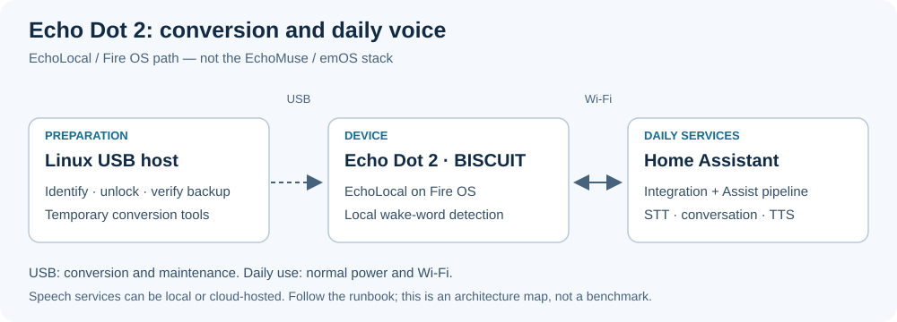

# Echo Dot 2 → EchoLocal → Home Assistant

[English](README.md) · [Русский](README.ru.md) · [Deutsch](README.de.md) · [Español](README.es.md) · [Français](README.fr.md)

Ce document est une présentation traduite accompagnée d’un parcours de démarrage. Les procédures détaillées et les commandes restent pour le moment maintenues en anglais ; les liens y renvoient. La langue du README ne change ni la reconnaissance, ni la voix de réponse, ni le mot d’activation.

Ce projet explique comment transformer un **Echo Dot de deuxième génération (RS03QR, BISCUIT)** existant en satellite vocal Home Assistant avec **EchoLocal**. Il fournit des procédures, des outils pour l’hôte USB et des étapes reproductibles d’entraînement et d’évaluation d’une phrase d’activation. Le dépôt ne contient ni firmware, ni enregistrements, ni modèles entraînés, ni identifiants.

## Premiers pas

1. Identifiez le modèle avec le [guide matériel](docs/hardware-compatibility.md), puis confirmez BISCUIT par USB. Un appareil appelé « Echo » dans HA ne prouve pas sa compatibilité.
2. Préparez un hôte USB Linux, une alimentation stable et un câble de données. Le parcours vérifié utilise un conteneur sur Synology ; suivez la [procédure ordonnée](docs/runbook.md).
3. Exécutez la [conversion](research/conversion.md) étape par étape : déverrouillage, TWRP, sauvegarde vérifiée après déverrouillage, puis versions compatibles de Fire OS et EchoLocal. L’USB sert à ces opérations et à la récupération.
4. Configurez dans HA l’intégration **ESPHome** et un **pipeline Assist** avec reconnaissance vocale, agent de conversation et synthèse. Choisissez la langue et associez le satellite à l’aide de sa clé. Vérifiez TCP 6053 et les adresses multimédias selon le [guide HA](research/ha-integration.md).
5. Vérifiez la voix normale, la réponse, le redémarrage et le fonctionnement prolongé avec le [plan de validation](docs/acceptance-and-batch.md). Après conversion, le Dot utilise le Wi-Fi et son alimentation habituelle ; une liaison USB de données permanente n’est pas nécessaire.

## Limites et validation

Le résultat du 2 octobre 2026 est un test historique d’EchoLocal 0.0.8, pas une garantie sur l’état actuel ou toutes les versions. Les phrases « Привет, Мышка » et « Привет, котик » restent expérimentales : des mesures synthétiques ne prouvent pas la fiabilité dans une pièce réelle. N’utilisez pas les images Dot 2 sur un Echo de grande taille, un Show ou une autre génération de Dot. HACS, Music Assistant et ESPHome Device Builder ne sont pas nécessaires à la voix de base. Un pipeline utilisant le cloud nécessite toujours un accès réseau.

## Documentation détaillée

- [Index](docs/README.md)
- [Entraînement et enregistrement](training/README.md)
- [Accès à l’appareil](docs/device-access.md)
- [Commandes et limites](docs/device-controls.md)
- [Musique](docs/music-latency.md)
- [Rapport de validation](docs/operations-findings.md)
- [Sécurité](SECURITY.md)
- [Publication et versions](docs/publication.md)
- [Contributions et traduction](docs/i18n.md)

## Projets associés

- [EchoMuse / emOS](https://github.com/ha-homelab/ha-echomuse)
- [Echo Show 5 / Android](https://github.com/ha-homelab/ha-echo-show-5)
- [Amazon Echo Home Energy / Alexa](https://github.com/4alvit/amazon-echo-home-voice)

EchoMuse avec emOS est une autre pile logicielle pour Dot. Sa configuration, ses accès et sa récupération sont documentés dans son dépôt. Le projet Alexa conserve la plateforme d’origine ; il ne crée pas un satellite Assist.
